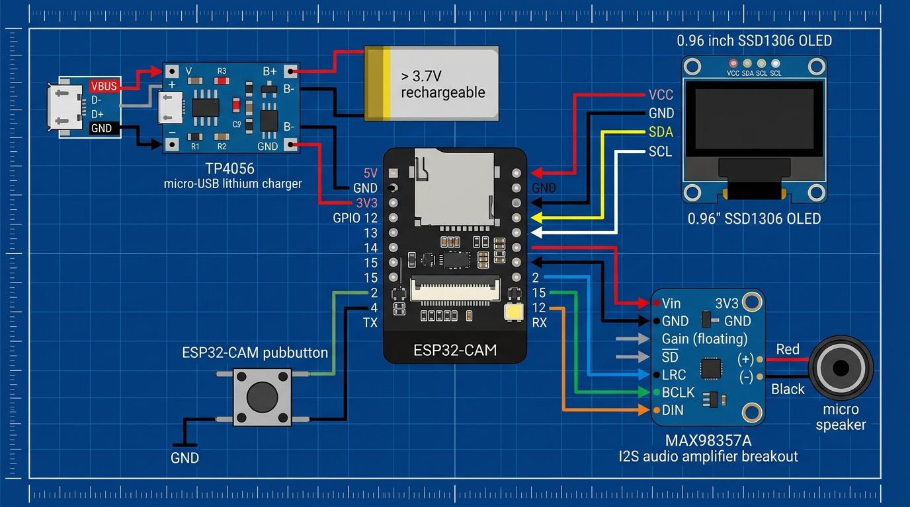

# ⚡ AI Smart Glasses — Quick Wiring Reference & Diagram

A concise, single-page wiring cheat sheet for the AI Smart Glasses assembly matching `smart_glasses_master.ino`.

---

## 🖼️ Complete Hardware Wiring Diagram



---

## 🔌 Connection Details by Component

### 1. 🖥️ OLED Display (0.96" SSD1306 I2C)
> **⚠️ Critical:** Connect VCC to **3.3V only** (5V will destroy the OLED). Requires 4.7kΩ pull-up resistors on both SDA & SCL to 3.3V.

| OLED Pin | ESP32-CAM Pin | Recommended Wire Color | Notes |
|:---|:---|:---:|:---|
| **VCC** | **3.3V / 3V3** | 🔴 Red | 3.3V power only |
| **GND** | **GND** | ⚫ Black | Common Ground |
| **SDA** | **GPIO 13** | 🔵 Blue | I2C Data + 4.7kΩ pull-up to 3.3V |
| **SCL / SCK** | **GPIO 14** | 🟡 Yellow | I2C Clock + 4.7kΩ pull-up to 3.3V |

---

### 2. 🔊 MAX98357A I2S Amplifier + Micro Speaker
> **💡 Tip:** Connect VIN to **5V** for full, crisp audio volume (3.3V works but has lower volume).

| MAX98357A Pin | ESP32-CAM Pin | Wire Color | Notes |
|:---|:---|:---:|:---|
| **VIN** | **5V** | 🔴 Red | Power from battery / 5V rail |
| **GND** | **GND** | ⚫ Black | Common Ground |
| **LRC (WS)** | **GPIO 2** | 🟢 Green | Word Select (Left/Right clock) |
| **BCLK** | **GPIO 4** | 🟠 Orange | Bit Clock |
| **DIN** | **GPIO 12** | 🟣 Purple | Audio Data Input |
| **SD** | *Unconnected* | — | Leave floating (active always-on) |
| **GAIN** | *Unconnected* | — | Leave floating (default +9dB gain) |

#### 🔈 Speaker Terminals:
- **Speaker Red wire (+)** ➔ MAX98357A **Speaker +** terminal
- **Speaker Black wire (−)** ➔ MAX98357A **Speaker −** terminal

---

### 3. 🔘 Single Smart Push Button (Multifunction)
> **💡 Note:** Uses ESP32 internal pull-up (`INPUT_PULLUP`). **No external resistor needed!**

| Button Leg | ESP32-CAM Pin | Function |
|:---|:---|:---|
| **Leg A** | **GPIO 15** | Signal pin |
| **Leg B** | **GND** | Ground return |

- **Short Press (< 1.2s):** Capture Photo & Query AI
- **Long Press (≥ 1.2s):** Switch Mode (`VISION` ➔ `OCR` ➔ `TRANSLATE`)

---

### 4. 🔋 Battery & Power System (3.7V LiPo + TP4056)

| From | To | Wire Color | Notes |
|:---|:---|:---:|:---|
| **LiPo Battery Red (+)** | **TP4056 B+** | 🔴 Red | Battery positive |
| **LiPo Battery Black (−)** | **TP4056 B−** | ⚫ Black | Battery negative |
| **TP4056 OUT+** | **ESP32-CAM 5V** | 🔴 Red | Powers board regulator & amp |
| **TP4056 OUT−** | **ESP32-CAM GND** | ⚫ Black | System ground |

*(Optional: Place a small slide switch in series on the **OUT+ ➔ 5V** wire for ON/OFF control).*

---

## 📌 Master ESP32-CAM Pin Map Summary

```
                    ┌──────────────────────┐
                    │      ESP32-CAM       │
                    │                      │
        Battery + ──┤ 5V      [CAMERA]     │
       Common GND ──┤ GND                  │
         OLED VCC ──┤ 3V3                  │
      Speaker DIN ──┤ GPIO 12      GPIO 2  ├── Speaker LRC
         OLED SDA ──┤ GPIO 13      GPIO 4  ├── Speaker BCLK
         OLED SCL ──┤ GPIO 14     GPIO 15  ├── Button (to GND)
                    └──────────────────────┘
```

| ESP32-CAM Pin | Connected To | Function / Protocol |
|:---|:---|:---|
| **5V** | TP4056 OUT+ & MAX98357A VIN | 5V Power Input / Amp Power |
| **3V3** | OLED VCC (and 4.7kΩ pull-up resistors) | 3.3V Logic Rail |
| **GND** | TP4056 OUT−, OLED GND, Amp GND, Button Leg B | Common Ground |
| **GPIO 2** | MAX98357A **LRC** | I2S Word Select (Audio) |
| **GPIO 4** | MAX98357A **BCLK** | I2S Bit Clock (Audio) |
| **GPIO 12** | MAX98357A **DIN** | I2S Data (Audio) |
| **GPIO 13** | OLED **SDA** | I2C Serial Data |
| **GPIO 14** | OLED **SCL** | I2C Serial Clock |
| **GPIO 15** | Button Leg A | Single Multifunction Button |

---

## ⚠️ 4 Key Rules to Avoid Damage

1. **OLED is 3.3V only:** Connecting OLED VCC to 5V will burn out the display.
2. **I2C Pull-ups:** If OLED is blank, ensure 4.7kΩ resistors are installed between 3.3V and GPIO 13 (SDA), and 3.3V and GPIO 14 (SCL).
3. **Flashing vs Running:**
   - **Flashing code:** Bridge **GPIO 0 to GND** and press reset.
   - **Running code:** **Disconnect GPIO 0 from GND** and press reset.
4. **Speaker Power:** Powering MAX98357A from 5V prevents audio distortion or brownout resets during peak volume.
